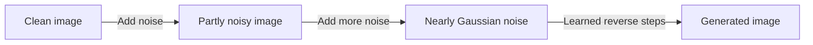

> [!example] Implementation
> [Browse the code](https://github.com/Ishan8840/deep-learning/tree/main/02-generative-models/02-ddpm) on GitHub.

[`ddpm.py`](https://github.com/Ishan8840/deep-learning/blob/main/02-generative-models/02-ddpm/ddpm.py) implements the forward-noise and reverse-denoising equations. [`train.py`](https://github.com/Ishan8840/deep-learning/blob/main/02-generative-models/02-ddpm/train.py) trains on MNIST; [`sampling.py`](https://github.com/Ishan8840/deep-learning/blob/main/02-generative-models/02-ddpm/sampling.py) and [`generate_grid.py`](https://github.com/Ishan8840/deep-learning/blob/main/02-generative-models/02-ddpm/generate_grid.py) produce examples.

```bash
uv run python 02-generative-models/02-ddpm/train.py --download --epochs 1
```

> A DDPM learns to generate images by reversing a gradual noising process. During training, it predicts the noise in a corrupted real image. During generation, it starts from Gaussian noise and repeatedly takes a small step toward a cleaner image.

## 1. The two processes

**Forward diffusion** is a fixed procedure that progressively destroys image information. **Reverse diffusion** is a learned procedure that turns noise into samples resembling the training data.



The generated image does not have to reproduce a particular training example. In unconditional generation, the model receives neither a real image nor a digit label.

### Notation

| Symbol | Meaning |
| --- | --- |
| $x_0$ | Clean image; normalized to $[-1,1]$ in our MNIST implementation |
| $x_t$ | Image after $t$ forward transitions |
| $T$ | Total number of diffusion steps |
| $\beta_t$ | Variance of the noise added at one step |
| $\alpha_t=1-\beta_t$ | Signal retention factor for one step |
| $\bar\alpha_t=\prod_{s=1}^{t}\alpha_s$ | Cumulative signal retention factor |
| $\epsilon\sim\mathcal N(0,I)$ | Standard Gaussian noise |
| $\epsilon_\theta(x_t,t)$ | Neural network's prediction of that noise |
| $q$ | Fixed forward distributions |
| $p_\theta$ | Learned reverse distributions |

> [!important] Paper timesteps versus Python indices
> The equations here use $t=1,\ldots,T$, with $x_0$ reserved for the clean image and $\bar\alpha_0=1$. Our code uses schedule indices `0, ..., T-1`. Thus `alpha_bars[0]` corresponds to mathematical $\bar\alpha_1$, and index `999` is the last step of a 1,000-step schedule. The code's final reverse call is at index `0`.

## 2. Forward diffusion: add noise

The forward process is a Markov chain: the next state depends only on the current state.

$$
q(x_{1:T}\mid x_0)=\prod_{t=1}^{T}q(x_t\mid x_{t-1})
$$

Each transition is Gaussian:

$$
q(x_t\mid x_{t-1})
=\mathcal N\left(\sqrt{\alpha_t}\,x_{t-1},\beta_t I\right).
$$

Equivalently, draw fresh noise $z_t\sim\mathcal N(0,I)$ and compute

$$
x_t=\sqrt{\alpha_t}\,x_{t-1}+\sqrt{\beta_t}\,z_t.
$$

The signal is multiplied by a number below one while independent noise is added. Repeating this gradually removes information about the original image.

### Jump directly to any timestep

We do not need to simulate the preceding steps to create a training example. Composing the Gaussian transitions gives

$$
q(x_t\mid x_0)
=\mathcal N\left(\sqrt{\bar\alpha_t}\,x_0,(1-\bar\alpha_t)I\right),
$$

so we can sample directly:

$$
\boxed{x_t=\sqrt{\bar\alpha_t}\,x_0+\sqrt{1-\bar\alpha_t}\,\epsilon.}
$$

Here $\epsilon$ represents the combined noise at this timestep, rather than just the noise from the most recent transition.

In our implementation:

```python
# x0: [B, C, H, W]; t: [B], dtype=torch.long

def q_sample(x0, t):
    eps = torch.randn_like(x0)
    alpha_bar = alpha_bars[t].view(-1, 1, 1, 1)
    xt = alpha_bar.sqrt() * x0 + (1 - alpha_bar).sqrt() * eps
    return xt, eps
```

The reshape broadcasts one noise level across each image. Different images in a batch can have different timesteps. Images, timesteps, and schedule tensors must be on compatible devices.

## 3. The noise schedule

A schedule specifies how corruption changes over time. The forward schedule is fixed in this project; gradient descent updates the U-Net, not the betas.

Our original setup is:

```python
betas = torch.linspace(0.0001, 0.02, steps=1000)
alphas = 1 - betas
alpha_bars = torch.cumprod(alphas, dim=0)
```

- `betas` increases: each transition adds more noise.
- `alphas` decreases slightly: each transition retains slightly less signal.
- `alpha_bars` falls toward zero: repeated attenuation removes almost all original signal.

The coefficients multiplying the image and noise are **square roots** of these variance-related quantities. They are not interchangeable with the quantities themselves.

A useful measure is the signal-to-noise ratio:

$$
\operatorname{SNR}(t)=\frac{\bar\alpha_t}{1-\bar\alpha_t}.
$$

For the original schedule, $\bar\alpha_T\approx4.04\times10^{-5}$. The terminal distribution is therefore close to standard Gaussian noise, making $x_T\sim\mathcal N(0,I)$ a reasonable starting point for generation.

### Reducing the number of steps

Reducing $T$ also requires thinking about the schedule. Using only 100 steps with the original beta endpoints leaves substantial signal at the end.

Our experiments used:

| Steps | Schedule | Final $\bar\alpha_T$ |
| --- | --- | --- |
| 1,000 | Linear betas: $0.0001\rightarrow0.02$ | $4.04\times10^{-5}$ |
| 100 | Linear betas: $0.001\rightarrow0.2$ | $2.04\times10^{-5}$ |
| 10 | Combine groups of 100 original transitions | $4.04\times10^{-5}$ |

For a group of original steps, the combined beta is

$$
\beta'_k=1-\prod_{s\in\text{group }k}(1-\beta_s).
$$

This preserves cumulative signal retention at group boundaries. Simply multiplying beta endpoints by 100 would produce invalid values above one.

Fewer steps mean larger reverse corrections. Preserving the terminal noise level does **not** guarantee equally good generation. Our shortened schedules were trained from scratch; we did not merely skip calls in the original sampler.

## 4. What the U-Net learns

The network receives a noisy image and its timestep:

$$
(x_t,t)\longmapsto\epsilon_\theta(x_t,t).
$$

Its output has the same shape as the image. It predicts the noise realization, not a digit class or a single scalar noise level.

### Timestep conditioning

The same image pattern can require different treatment at different noise levels. A timestep embedding tells the model which denoising problem it is solving.

Our code maps the timestep into sine and cosine features at multiple frequencies. Each residual block projects that embedding to its channel width and adds it to its image features.

### Our final architecture

```text
28×28, 1 channel
    ↓ residual block
28×28, 64 channels ─────────────────────────── skip ──┐
    ↓ downsample                                     │
14×14, 128 channels ─────────────── skip ──┐            │
    ↓ downsample                         │            │
 7×7, 256 channels                        │            │
    ↓ bottleneck                         │            │
    ↑ upsample + concatenate skip ◀──────┘            │
14×14, 128 channels                                    │
    ↑ upsample + concatenate skip ◀───────────────────┘
28×28, 64 channels
    ↓ output convolution
28×28, 1 predicted-noise channel
```

Each residual block uses two 3×3 convolutions, GroupNorm, and SiLU, with timestep conditioning between the convolution stages. An identity or 1×1 projection provides the residual shortcut.

The model has **4,206,593 parameters**. Skip connections preserve spatial detail; downsampling lets later features combine information over larger parts of the image.

## 5. Training: predict known noise

For each minibatch:

1. Load real MNIST images and normalize them to $[-1,1]$.
2. Sample a timestep independently for each image.
3. Sample Gaussian noise and construct $x_t$ directly with `q_sample`.
4. Predict the noise using the U-Net.
5. Minimize mean squared error and update the model.

$$
\boxed{L_{\mathrm{simple}}
=\mathbb E_{x_0,t,\epsilon}
\left[\|\epsilon-\epsilon_\theta(x_t,t)\|^2\right].}
$$

```python
t = torch.randint(0, len(betas), (x0.shape[0],), device=x0.device)
xt, eps = q_sample(x0, t)
eps_pred = model(xt, t)
loss = F.mse_loss(eps_pred, eps)

optimizer.zero_grad()
loss.backward()
optimizer.step()
```

PyTorch's default MSE averages over batch and image coordinates. This differs from a summed squared norm by a constant factor when image size is fixed.

**Training does not run the full reverse chain per example.** It uses one sampled noise level and one model prediction. Reducing diffusion steps therefore does not make each training epoch 10× or 100× faster. Generation does use one model evaluation per reverse step.

## 6. Generation: repeatedly remove noise

The reverse chain starts from a simple prior:

$$
p(x_T)=\mathcal N(0,I),\qquad
p_\theta(x_{0:T})=p(x_T)\prod_{t=1}^{T}p_\theta(x_{t-1}\mid x_t).
$$

We model each reverse transition as

$$
p_\theta(x_{t-1}\mid x_t)
=\mathcal N\left(\mu_\theta(x_t,t),\sigma_t^2I\right).
$$

In our noise-prediction parameterization, the mean is

$$
\boxed{\mu_\theta(x_t,t)
=\frac{1}{\sqrt{\alpha_t}}
\left(x_t-\frac{\beta_t}{\sqrt{1-\bar\alpha_t}}
\epsilon_\theta(x_t,t)\right).}
$$

Our sampler chooses $\sigma_t^2=\beta_t$ and computes

$$
x_{t-1}=\mu_\theta(x_t,t)+\sigma_t z,
\qquad z\sim\mathcal N(0,I).
$$

The last transition uses the mean without adding fresh noise. In Python:

```python
model.eval()
with torch.no_grad():
    x = torch.randn(64, 1, 28, 28, device=device)
    for t in reversed(range(len(betas))):
        x = p_sample_step(model, x, t)

    display = ((x + 1) / 2).clamp(0, 1)
```

The 64 initial images contain independent Gaussian draws. No clean image is supplied. Each batch position keeps its own trajectory throughout sampling.

Display conversion is separate from sampling: clamp a visualization copy, not the state used by the next reverse step. Load the checkpoint's saved schedule as well as its weights; weights trained for one schedule should not silently be sampled using another.

## 7. Why one-step reconstruction can look worse

Given a noisy real image, we can estimate the clean image directly:

$$
\hat x_0=
\frac{x_t-\sqrt{1-\bar\alpha_t}\,\epsilon_\theta(x_t,t)}
{\sqrt{\bar\alpha_t}}.
$$

The denominator is necessary: it undoes the signal scaling in forward diffusion. Removing it produces a scaled estimate, not a corrected reconstruction.

Subtracting the true $x_0$ gives a useful error identity:

$$
\hat x_0-x_0
=\sqrt{\frac{1-\bar\alpha_t}{\bar\alpha_t}}
\left(\epsilon-\epsilon_\theta(x_t,t)\right).
$$

At high noise levels, the multiplier is large. Even a small noise-prediction error can become a large clean-image error. Meanwhile, little information remains about which original digit produced the noisy input.

| One-step reconstruction | Full generation |
| --- | --- |
| Estimates the entire clean image in one prediction | Makes many successive reverse transitions |
| Compared against a particular original image | Can produce any plausible image from the data distribution |
| Becomes ambiguous when the original signal disappears | Gradually develops a sample through the reverse chain |

A poor $\hat x_0$ at the last timestep does not, by itself, demonstrate a broken sampler. For a different reconstruction experiment, start from a noisy real image and run every remaining reverse transition. At high noise, the resulting digit may differ from the original.

## 8. Connection to variational inference

Like a [VAE](../02-vae/index.md), a DDPM is a latent-variable model. Here the latent variables are the noisy image states $x_1,\ldots,x_T$, all with the same dimensionality as the data. The forward chain supplies a fixed approximate posterior rather than a learned encoder.

The probability of a clean image integrates over all latent trajectories:

$$
p_\theta(x_0)=\int p_\theta(x_{0:T})\,dx_{1:T}.
$$

This integral is generally intractable. Introduce the forward distribution, apply Jensen's inequality, and obtain an upper bound on negative log likelihood:

$$
-\log p_\theta(x_0)
\leq
\mathbb E_{q(x_{1:T}\mid x_0)}
\left[\log\frac{q(x_{1:T}\mid x_0)}{p_\theta(x_{0:T})}\right]
= L_{\mathrm{VLB}}.
$$

Its decomposition separates three jobs:

$$
\begin{aligned}
L_{\mathrm{VLB}}={}&
D_{\mathrm{KL}}\big(q(x_T\mid x_0)\|p(x_T)\big)\\
&+\sum_{t=2}^{T}\mathbb E_{q(x_t\mid x_0)}
D_{\mathrm{KL}}\big(q(x_{t-1}\mid x_t,x_0)\|p_\theta(x_{t-1}\mid x_t)\big)\\
&-\mathbb E_{q(x_1\mid x_0)}\log p_\theta(x_0\mid x_1).
\end{aligned}
$$

The terms match the terminal distribution to the prior, match intermediate reverse transitions, and reconstruct the clean image from the first noisy state. The terminal term is constant with respect to the model parameters when the forward schedule and prior are fixed.

### The tractable training posterior

Although $q(x_{t-1}\mid x_t)$ is generally difficult, conditioning on the known training image makes the posterior Gaussian:

$$
q(x_{t-1}\mid x_t,x_0)
=\mathcal N(\tilde\mu_t,\tilde\beta_t I),
$$

$$
\tilde\mu_t=
\frac{\sqrt{\bar\alpha_{t-1}}\beta_t}{1-\bar\alpha_t}x_0
+\frac{\sqrt{\alpha_t}(1-\bar\alpha_{t-1})}{1-\bar\alpha_t}x_t,
\qquad
\tilde\beta_t=\beta_t\frac{1-\bar\alpha_{t-1}}{1-\bar\alpha_t}.
$$

For $t\geq2$, fixed variances reduce the trainable part of the Gaussian KL to a weighted squared error:

$$
L_{t-1}=
\mathbb E_q\left[
\frac{\|\tilde\mu_t-\mu_\theta(x_t,t)\|^2}{2\sigma_t^2}
\right]+C.
$$

Here $C$ is independent of $\theta$, but can depend on the timestep. The variance $\sigma_t^2$ may vary with time even though it is not learned. The identity covariance means conditional noise coordinates are independent; it does not make the generated image's pixels independent overall.

### Weighted variational loss versus simple MSE

Substituting the noise parameterization into the mean-matching term yields

$$
L_{t-1}=
\mathbb E\left[
\frac{\beta_t^2}{2\sigma_t^2\alpha_t(1-\bar\alpha_t)}
\|\epsilon-\epsilon_\theta(x_t,t)\|^2
\right]+C.
$$

**Our implementation drops this timestep-dependent weight** and trains with $L_{\mathrm{simple}}$. These objectives are related, but they are not identical. Retain the weight when reproducing the exact intermediate variational terms; omit it intentionally when using the simplified noise-prediction objective.

The original DDPM experiments use fixed reverse variances and motivate the simplified noise-prediction objective; both $\beta_t$ and $\tilde\beta_t$ are discussed as variance choices. Their likelihood and visual-quality results also illustrate why these are different evaluation targets. See [Ho et al., Sections 3–4](https://arxiv.org/pdf/2006.11239).

## 9. Our MNIST experiments

These are observations from this project, not benchmark claims. Training used Adam; the later experiments used batch size 64 and learning rate $10^{-4}$.

| Architecture | Steps | Epochs | Learning rate | Final training MSE |
| --- | ---: | ---: | ---: | ---: |
| Small, one downsampling level | 1,000 | 20 | 0.001 | 0.027637 |
| Wider, one downsampling level | 1,000 | 20 | 0.001 | 0.028477 |
| Wider, one downsampling level | 1,000 | 20 | 0.0001 | 0.027591 |
| Deeper, two convolutions per residual block | 1,000 | 20 | 0.0001 | 0.022693 |
| Same deeper model, resumed | 1,000 | 25 | 0.0001 | 0.022013 |
| Deeper model, fresh training | 100 | 25 | 0.0001 | 0.021586 |
| Deeper model, fresh training | 10 | 25 | 0.0001 | 0.015903 |
| Same 10-step model, resumed | 10 | 35 | 0.0001 | 0.015760 |

### What we observed

- Increasing width alone did not clearly improve generation. The wider model at learning rate 0.001 had a large temporary loss spike.
- Adding the 7×7 level and a second convolution per residual block produced visibly more coherent digits in the 64-sample grids.
- The 100-step model generated many recognizable digits with 100 model evaluations.
- The 10-step model also generated recognizable digits, but its grids showed more background noise and rough or malformed strokes.
- Extending the 10-step run from 25 to 35 epochs reduced training loss slightly; visual quality remained broadly similar.

The architecture change altered several things at once, so it does not isolate which change caused the improvement. The shorter schedules also change the distribution of training noise levels: **their lower MSE is not evidence that they are better generators**.

### What we have not established

We did not track held-out loss during these runs, so we cannot rule out overfitting. A single reconstructed test image is a diagnostic, not a generalization study. Visual inspection of 64 samples is more informative than two samples, but is still qualitative.

For a stronger comparison, evaluate checkpoints on the same held-out images with fixed timestep/noise draws, report loss by noise level, and inspect multiple generated batches. The same seed only reproduces the same random draws within a compatible execution setup; CPU and CUDA generators can differ.

## 10. Practical reminders

- **Training target:** predict the sampled noise, using a timestep for each image.
- **Generation:** start from Gaussian noise and traverse every trained reverse step.
- **Final reverse step:** do not add fresh noise.
- **Inference:** use `model.eval()` and `torch.no_grad()`.
- **Checkpoint compatibility:** architecture and saved schedule must match the trained weights.
- **Display:** map $[-1,1]$ to $[0,1]$ and clamp only a display copy.
- **Evaluation:** training loss, held-out loss, likelihood, and visual quality answer different questions.

## References

- [Denoising Diffusion Probabilistic Models — Ho, Jain, and Abbeel (2020)](https://arxiv.org/abs/2006.11239)
- Related notes: [VAE](../02-vae/index.md), CNN, Loss Functions
