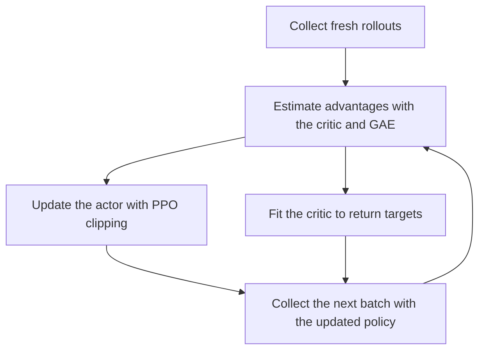

> [!example] Implementation
> [Browse the code](https://github.com/Ishan8840/deep-learning/tree/main/03-reinforcement-learning/05-ppo) on GitHub.

**PPO** is an on-policy actor–critic algorithm designed to improve a policy while discouraging overly aggressive updates. These notes focus on **PPO-Clip**, the version that uses a clipped surrogate objective.

[`model.py`](https://github.com/Ishan8840/deep-learning/blob/main/03-reinforcement-learning/05-ppo/model.py) adapts the PPO script from my `pendulum-V1` repo. It trains a continuous-action Gaussian actor and value critic on Pendulum-v1, using [GAE](../05-generalized-advantage-estimation/index.md) and PPO clipping. It reports the environment's raw reward; it does not use the source script's reward shaping. The repository does not include a trained checkpoint or benchmark result.

```bash
uv run --extra rl python 03-reinforcement-learning/05-ppo/model.py --episodes 1000
```

Evaluation runs without a window by default; pass `--render` to watch it. The tanh action transform's constant scale factor is omitted from the stored log-probability because it cancels in the PPO probability ratio.

## PPO at a glance



| Component | Role |
| --- | --- |
| Actor $\pi_\theta(a\mid s)$ | Chooses actions and learns to favor those with positive advantage |
| Critic $V_\phi(s)$ | Estimates expected returns and helps compute advantages |
| GAE $\hat A_t$ | Estimates how much better or worse an action was than expected |
| PPO clipping | Removes the incentive for excessively large changes in the favored direction |

PPO commonly uses [Generalized Advantage Estimation](../05-generalized-advantage-estimation/index.md) to compute advantages. It then performs several epochs of minibatch updates on the collected data, updating both the actor and critic. The old action probabilities remain fixed throughout those updates.

**On-policy** means each training round uses fresh experience from its rollout policy. Reusing that batch for several optimization epochs is part of PPO; afterward, the updated policy collects a new batch.

## The probability ratio

Trajectories are collected using the old policy $\pi_{\theta_{\mathrm{old}}}$. During optimization, the current policy $\pi_\theta$ changes while the old policy remains fixed for that batch.

For a sampled state–action pair $(s_t,a_t)$, define:

$$
r_t(\theta)
=\frac{\pi_\theta(a_t\mid s_t)}
{\pi_{\theta_{\mathrm{old}}}(a_t\mid s_t)}
$$

The ratio asks: **How much more or less likely is the current policy to take the same action in the same state?** Here, $r_t$ denotes the ratio, not the environment reward. For continuous actions, the ratio uses probability densities.

For example:

$$
\pi_{\mathrm{old}}(a_t\mid s_t)=0.20,
\qquad
\pi_\theta(a_t\mid s_t)=0.24
$$

$$
r_t=\frac{0.24}{0.20}=1.2
$$

The action is now **20% more likely**.

| Ratio | Interpretation |
| --- | --- |
| $r_t=1$ | The action’s probability has not changed |
| $r_t>1$ | The action has become more likely |
| $r_t<1$ | The action has become less likely |

At the start of optimization on a newly collected batch, $\theta=\theta_{\mathrm{old}}$, so $r_t=1$.

## Combine the ratio with advantage

The advantage estimate $\hat A_t$, often computed using [Generalized Advantage Estimation](../05-generalized-advantage-estimation/index.md), measures whether the sampled action was better or worse than expected under the rollout policy.

- **$\hat A_t>0$:** Encourage increasing the action’s probability.
- **$\hat A_t<0$:** Encourage decreasing the action’s probability.

The unclipped surrogate objective is:

$$
L^{\mathrm{CPI}}(\theta)
=\hat{\mathbb E}_t\left[r_t(\theta)\hat A_t\right]
$$

Here, $\hat{\mathbb E}_t$ means the empirical average over the batch. **We maximize this objective**, keeping the advantage estimates fixed during the actor update. CPI refers to conservative policy iteration.

| Advantage | Ratio change | Objective contribution | Effect |
| --- | --- | --- | --- |
| $\hat A_t=+5$ | $1\rightarrow2$ | $5\rightarrow10$ | Increasing a good action’s probability improves the objective |
| $\hat A_t=-5$ | $1\rightarrow0.5$ | $-5\rightarrow-2.5$ | Decreasing a bad action’s probability also improves the objective |

## Why unrestricted updates are a problem

The unclipped objective keeps rewarding larger changes in the favored direction. For positive advantage, increasing $r_t$ keeps increasing $r_t\hat A_t$.

Repeated optimization on the same batch can therefore move the policy far from the policy that collected it. The advantages describe behavior under the old policy, and the surrogate becomes a less reliable guide as the policy and its visited-state distribution change.

PPO modifies the objective to limit the incentive for these large updates.

## The clipped surrogate objective

Choose a clipping parameter $\epsilon$, for example $\epsilon=0.2$. The clipping interval is then $[0.8,1.2]$.

$$
L^{\mathrm{CLIP}}(\theta)
=\hat{\mathbb E}_t
\left[
\min\left(
 r_t(\theta)\hat A_t,
 \operatorname{clip}\bigl(r_t(\theta),1-\epsilon,1+\epsilon\bigr)\hat A_t
\right)
\right]
$$

For each sample, PPO takes the smaller of the unclipped and clipped contributions. The sign of the advantage determines which side becomes flat.

### Positive advantage: stop rewarding large increases

Let $\hat A_t=+5$ and $\epsilon=0.2$.

| $r_t$ | Unclipped contribution | Clipped contribution | PPO takes the minimum |
| --- | --- | --- | --- |
| $1.0$ | $5$ | $5$ | $5$ |
| $1.1$ | $5.5$ | $5.5$ | $5.5$ |
| $1.2$ | $6$ | $6$ | $6$ |
| $2.0$ | $10$ | $6$ | $6$ |

Once $r_t>1+\epsilon$, increasing the probability further gives **no additional improvement in this sample’s objective contribution**.

### Negative advantage: stop rewarding large decreases

Let $\hat A_t=-5$ and $\epsilon=0.2$.

| $r_t$ | Unclipped contribution | Clipped contribution | PPO takes the minimum |
| --- | --- | --- | --- |
| $1.0$ | $-5$ | $-5$ | $-5$ |
| $0.9$ | $-4.5$ | $-4.5$ | $-4.5$ |
| $0.8$ | $-4$ | $-4$ | $-4$ |
| $0.5$ | $-2.5$ | $-4$ | $-4$ |

Because the objective is maximized, $-4$ is an improvement over $-5$. But once $r_t<1-\epsilon$, decreasing the probability further gives no additional improvement for this sample.

## Why take the minimum instead of just clipping?

Simply clipping the ratio would flatten the objective on both sides, including when the policy moves in the wrong direction. The minimum preserves the penalty for those changes.

For example:

- **Good action made much less likely:** With $\hat A_t=+5$ and $r_t=0.5$, the unclipped contribution is $2.5$ and the clipped contribution is $4$. PPO takes **$2.5$**.
- **Bad action made much more likely:** With $\hat A_t=-5$ and $r_t=2$, the unclipped contribution is $-10$ and the clipped contribution is $-6$. PPO takes **$-10$**.

The per-sample objective can equivalently be written as:

$$
\ell_t^{\mathrm{CLIP}}
=\begin{cases}
\hat A_t\min\bigl(r_t,1+\epsilon\bigr), & \hat A_t\geq0, \\
\hat A_t\max\bigl(r_t,1-\epsilon\bigr), & \hat A_t<0.
\end{cases}
$$

This is a **pessimistic surrogate**: it is a lower bound on the unclipped surrogate, not a guarantee about the policy’s actual return. Clipping removes incentives for large beneficial-looking changes while allowing harmful changes to worsen the objective. See [Section 3 of the PPO paper](https://arxiv.org/pdf/1707.06347#page=3).

## Clipping is not a hard constraint

PPO does **not** force every ratio to stay inside $[1-\epsilon,1+\epsilon]$. Clipping changes the objective; it does not clamp the policy’s actual probabilities.

A sample’s contribution can become flat while updates from other samples still change its probability through shared parameters.

When using an optimizer that minimizes a loss, the actor loss is typically the negative of this maximization objective:

$$
\mathcal L_{\mathrm{actor}}=-L^{\mathrm{CLIP}}
$$

## Why use PPO?

PPO combines policy-gradient learning, an actor–critic setup, and a surrogate objective that discourages large policy changes. GAE commonly supplies the advantage estimates.

Compared with TRPO’s explicit constrained optimization, PPO-Clip uses a simpler objective that can be optimized with ordinary first-order gradient methods. This makes it practical for training neural-network policies, although clipping does not guarantee stable learning or monotonic improvement.

### Sources
[Proximal Policy Optimization Algorithms](https://arxiv.org/pdf/1707.06347)
