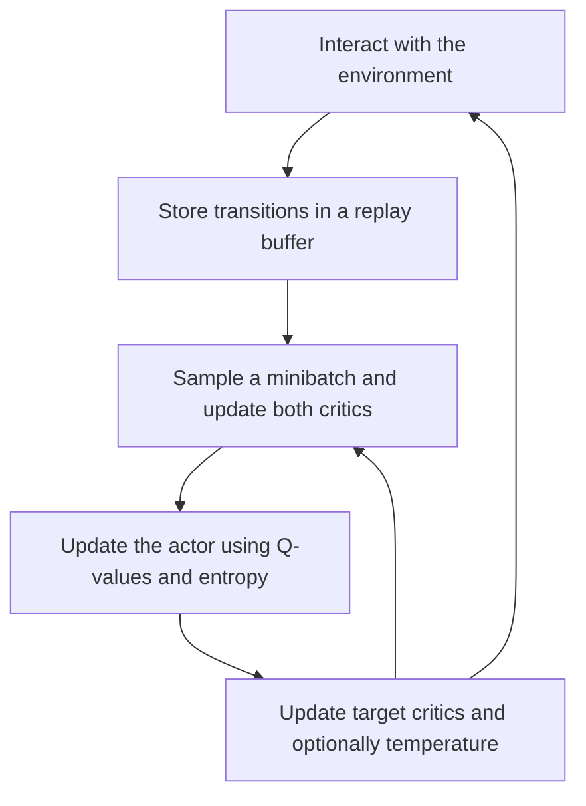

**Soft Actor-Critic (SAC)** is an off-policy actor–critic algorithm that combines reward maximization with an entropy bonus. These notes focus on the common continuous-control version with a stochastic actor and two Q-function critics.

## SAC at a glance

The replay buffer lets SAC reuse experience collected by earlier policies. The entropy bonus encourages the actor to remain stochastic while seeking high rewards.

| Component | Role |
| --- | --- |
| Actor $\pi_\theta(a\mid s)$ | Samples actions and learns to balance value with entropy |
| Critics $Q_{\phi_1}(s,a)$, $Q_{\phi_2}(s,a)$ | Estimate the entropy-regularized value of state–action pairs |
| Replay buffer $\mathcal D$ | Stores transitions for repeated training |
| Temperature $\alpha$ | Controls the weight of entropy relative to reward |

## Maximum-entropy objective

In the discounted setting, ordinary reward maximization uses:

$$
J_{\mathrm{reward}}(\pi)
=\mathbb E_{\tau\sim\pi}
\left[\sum_{t=0}^{\infty}\gamma^t r_t\right]
$$

SAC adds a policy-entropy bonus:

$$
J_{\mathrm{SAC}}(\pi)
=\mathbb E_{\tau\sim\pi}
\left[
\sum_{t=0}^{\infty}\gamma^t
\left(r_t+\alpha\mathcal H\bigl(\pi(\cdot\mid s_t)\bigr)\right)
\right]
$$

Here, $\tau$ is a trajectory, $\gamma$ discounts future rewards and entropy bonuses, and $\alpha>0$ sets their relative importance.

The goal is to achieve high reward while retaining policy entropy, which can help exploration and discourage premature convergence to a narrow behavior.

## Entropy is average surprise

Entropy is the **expected** negative log-probability of an action sampled from the policy:

$$
\mathcal H\bigl(\pi(\cdot\mid s)\bigr)
=\mathbb E_{a\sim\pi(\cdot\mid s)}
\left[-\log\pi(a\mid s)\right]
$$

A single $-\log\pi(a\mid s)$ is a sample of this quantity, not the entropy of the whole distribution.

For a **discrete-action example**, using natural logarithms:

| Action probability | Surprise $-\log\pi(a\mid s)$ | Interpretation |
| --- | --- | --- |
| $0.9$ | $\approx0.105$ | Expected outcome; little surprise |
| $0.01$ | $\approx4.605$ | Rare outcome; much more surprise |

Entropy averages surprise over all actions, weighted by their probabilities. A rare action’s large surprise does not by itself imply high entropy. A deterministic discrete policy has zero entropy; a more evenly spread discrete policy has higher entropy.

### Continuous-action distinction

For continuous actions, $\pi(a\mid s)$ is a **probability density**, and the expression defines differential entropy. Densities may exceed one, so differential entropy can be negative. The discrete rule “deterministic means zero entropy” does not carry over directly; a deterministic continuous policy is a point mass without an ordinary density.

The expectation formula explains SAC’s sampled entropy term:

$$
\alpha\mathcal H\bigl(\pi(\cdot\mid s)\bigr)
=\mathbb E_{a\sim\pi(\cdot\mid s)}
\left[-\alpha\log\pi(a\mid s)\right]
$$

## The stochastic actor

The actor samples actions from $\pi_\theta(a\mid s)$. A common continuous-control parameterization is a Gaussian followed by a $\tanh$ transformation to bound the actions.

The actor favors actions with high predicted Q-values while also encouraging entropy. Using the two critics, its maximization objective is:

$$
J_\pi(\theta)
=\mathbb E_{s\sim\mathcal D,\,a\sim\pi_\theta(\cdot\mid s)}
\left[
\min_{i\in\{1,2\}}Q_{\phi_i}(s,a)
-\alpha\log\pi_\theta(a\mid s)
\right]
$$

- The **Q term** favors valuable actions.
- The **negative log-density term**, averaged over sampled actions, encourages entropy.

States come from replay, but actions for the actor objective are sampled from the **current policy**. An implementation that minimizes losses uses $\mathcal L_\pi=-J_\pi$.

## The critics and soft Bellman target

Unlike the state-value critic $V(s)$ in our [PPO](../06-ppo/index.md) notes, SAC primarily learns **action-value functions** $Q(s,a)$.

These are *soft* Q-functions: under the convention used here, they include expected future entropy bonuses as well as rewards. The current action’s entropy term is added separately in the actor objective.

### Why two critics?

SAC learns two separately parameterized critics and uses their minimum:

$$
Q_{\min}(s,a)
=\min\left(Q_{\phi_1}(s,a),Q_{\phi_2}(s,a)\right)
$$

This helps reduce the overestimation that can arise when policy optimization exploits errors in learned Q-values. The critics share training data, so their errors need not be statistically independent.

### Critic target

For a replay transition $(s,a,r,s',d)$, sample a new next-state action:

$$
a'\sim\pi_\theta(\cdot\mid s')
$$

Then form the target:

$$
y
=r+\gamma(1-d)
\left[
\min_{i\in\{1,2\}}Q_{\bar\phi_i}(s',a')
-\alpha\log\pi_\theta(a'\mid s')
\right]
$$

Here, $Q_{\bar\phi_i}$ are slowly updated target critics. The indicator $d=1$ means a true terminal state, where future value is zero; a rollout cutoff alone need not be terminal.

Each critic minimizes squared prediction error against the same target:

$$
\mathcal L_{Q_i}
=\mathbb E\left[
\left(Q_{\phi_i}(s,a)-y\right)^2
\right],
\qquad i\in\{1,2\}
$$

The expectation covers replay transitions and the sampled next action. The target $y$ is held fixed during each critic update. These equations follow the [Spinning Up SAC formulation](https://spinningup.openai.com/en/latest/algorithms/sac.html#soft-actor-critic).

## Off-policy learning and replay

SAC stores transitions in a replay buffer:

$$
\mathcal D=\left\{(s_t,a_t,r_t,s_{t+1},d_t)\right\}
$$

It can repeatedly train on transitions collected by earlier policies. The recorded action $a_t$ trains the critic, while newly sampled current-policy actions are used in the actor objective and next-state target.

This reuse often makes SAC more efficient in **environment interactions** than on-policy methods such as PPO. It is especially useful when robot interactions are expensive. The advantage depends on the task and implementation; fewer interactions do not necessarily mean less computation or shorter wall-clock training.

## Temperature: the reward–entropy balance

| Temperature | Effect, holding reward scale fixed |
| --- | --- |
| Larger $\alpha$ | Gives entropy more weight and favors more stochastic behavior |
| Smaller $\alpha$ | Gives entropy less weight and prioritizes the Q-value term |

SAC can use a fixed temperature or learn it automatically to track a target entropy. Automatic tuning increases entropy pressure when entropy is below target and reduces it when entropy is above target. See [Soft Actor-Critic Algorithms and Applications](https://arxiv.org/abs/1812.05905).

## PPO versus SAC

| Aspect | PPO-Clip | SAC |
| --- | --- | --- |
| Data use | On-policy batches, reused for a few optimization epochs | Off-policy transitions reused through replay |
| Main critic | Usually $V(s)$ | Two soft Q-functions $Q(s,a)$ |
| Actor signal | Advantages, commonly estimated with GAE | Q-values plus an entropy term |
| Main actor objective | Clipped probability-ratio surrogate | Maximum-entropy objective |
| Replay buffer | Typically no persistent replay across policy iterations | Central to training |
| Environment sample efficiency | Often needs more fresh interactions | Often benefits from reusing past interactions |
| Implementation | Clipping, advantage estimation, actor and value updates | Replay, twin critics, target critics, stochastic actor, optional temperature tuning |
| Action spaces | Commonly used for discrete and continuous actions | These notes cover continuous control; discrete variants also exist |

PPO emphasizes limiting incentives for large policy updates on fresh rollout data. SAC emphasizes reusing experience to learn Q-values and a reward-seeking, entropy-regularized policy.

### Sources
[Soft Actor-Critic: Off-Policy Maximum Entropy Deep Reinforcement Learning with a Stochastic Actor](https://arxiv.org/pdf/1801.01290)
