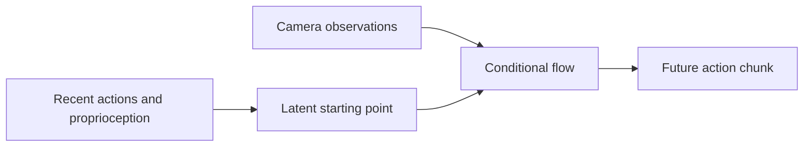

**Action-to-Action Flow Matching (A2A)** generates future actions from a starting point informed by the robot’s recent proprioceptive history. The core idea is to use the physical continuity of robot motion to make action generation easier.

## Motivation

Starting from random Gaussian noise, as in [Diffusion Policy](../02-diffusion-policy/index.md), often requires multiple refinement steps to produce clean actions. This adds inference latency and can become a bottleneck for real-time control.

Two other issues motivate A2A:

- **Proprioceptive information can get diluted.** Simply concatenating the current state with high-dimensional image features can overshadow the lower-dimensional proprioceptive signal.
- **Vision alone can be fragile.** [VITA Flow Matching](../04-vita-flow-matching/index.md) relies entirely on visual inputs, making it vulnerable to visual distractors in the environment.

## From historical actions to future actions

A2A uses historical actions to initialize generation in latent space. Because recent and future robot motions are related, this places the starting distribution closer to the target distribution.

The two input modalities serve different roles:

- **Proprioceptive history** provides the starting latent, capturing the robot’s dynamics and temporal continuity.
- **Visual observations** condition the flow, providing information about the scene and task.

Keeping these roles separate helps the model use both modalities without letting visual features dominate the proprioceptive signal.

Small amounts of noise can be added to historical actions before encoding. This introduces stochasticity and can help preserve some multimodality.

### Notation

| Symbol | Meaning |
| --- | --- |
| $a_{\leq t}$ | Historical action sequence |
| $a_{>t}$ | Future action sequence |
| $E_a$, $D_a$ | Action encoder and decoder |
| $z_0 = E_a(a_{\leq t})$ | Starting latent |
| $z_1 = E_a(a_{>t})$ | Target latent during training |
| $\hat z_1$ | Predicted latent obtained through ODE integration |
| $\tau \in [0,1]$ | Flow time, distinct from robot timestep $t$ |
| $z_\tau = (1-\tau)z_0+\tau z_1$ | Interpolated latent during training |
| $c$ | Visual conditioning vector |

## Training objectives

### Flow matching loss

The [Flow Matching](../../02-generative-models/05-flow-matching/index.md) objective trains the predicted vector field $f_\theta$ to match the target velocity $v_\tau$ between historical and future action latents.

$$
\mathcal L_{\mathrm{FM}}
= \mathbb E_{\tau\sim\mathcal U[0,1],\,z_0,z_1}
\left[
\left\|f_\theta(z_\tau,\tau,c)-v_\tau(z_\tau,\tau,c)\right\|_2^2
\right]
$$

### Autoencoder reconstruction loss

The [Autoencoder](../../02-generative-models/01-autoencoder/index.md) objective keeps the latent representation useful for reconstructing action chunks. It uses an $L_1$ reconstruction loss:

$$
\mathcal L_{\mathrm{AE}}
= \mathbb E_{a_{>t}}
\left[
\left\|a_{>t}-D_a\bigl(E_a(a_{>t})\bigr)\right\|_1
\right]
$$

### Inference consistency loss

This objective checks that ODE-generated latents match the encoded ground-truth actions and decode into accurate action sequences.

$$
\begin{aligned}
\mathcal L_{\mathrm{IC}}
={}&\mathbb E_{\hat z_1,\,a_{>t}}
\left[\left\|\hat z_1-E_a(a_{>t})\right\|_1\right] \\
&+\lambda_0\,\mathbb E_{\hat z_1,\,a_{>t}}
\left[\left\|D_a(\hat z_1)-a_{>t}\right\|_1\right]
\end{aligned}
$$

- The first term enforces agreement in **latent space**.
- The second term enforces agreement in **action space**, weighted by $\lambda_0$.

### Total loss

The three objectives are combined with positive weights:

$$
\mathcal L_{\mathrm{total}}
=\lambda_1\mathcal L_{\mathrm{FM}}
+\lambda_2\mathcal L_{\mathrm{AE}}
+\lambda_3\mathcal L_{\mathrm{IC}},
\qquad \lambda_1,\lambda_2,\lambda_3>0
$$

The loss definitions follow [Section 3.3 of the paper](https://arxiv.org/html/2602.07322v1#S3.SS3).

## Training configuration

The paper uses the following settings across its experiments:

| Parameter | Value |
| --- | --- |
| Action horizon $n$ | 8 |
| Observation horizon $m$ | 8 |
| Action-space term weight $\lambda_0$ | 0.5 |
| Flow matching weight $\lambda_1$ | 1 |
| Reconstruction weight $\lambda_2$ | 0.5 |
| Inference consistency weight $\lambda_3$ | 1 |
| Batch size | 32 |

## Limitation: discontinuous actions

A2A’s continuity prior is most useful for smooth control signals. It offers less benefit for discrete or switch-like action dimensions, such as binary gripper open/close commands.

## Sources

[Action-to-Action Flow Matching](https://arxiv.org/pdf/2602.07322)
